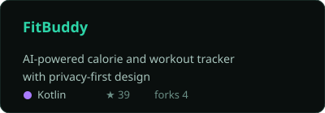
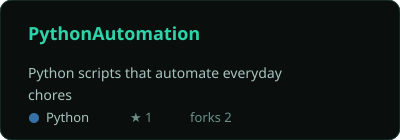
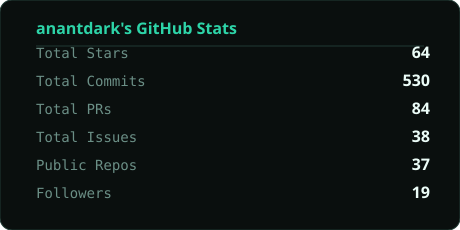
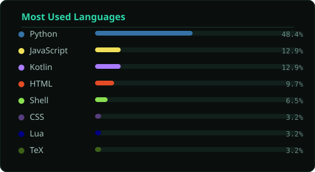

<!--
**anantdark/anantdark** is a special repository. This README appears on the GitHub profile.
-->

  

  
  
  

  

### About

AI engineer with a strong Python background. I build practical systems: agents, automations, and products that use models where they help and stay out of the way where they don’t.

Open source when it can be. Privacy by default.

<b>Quick facts</b>

 

- Building with Python, LLMs, and automation tooling
- Shipping useful open-source projects on GitHub
- Open to collaborating on AI-powered tools that respect users
- Reach me: [anantpatel2000@proton.me](mailto:anantpatel2000@proton.me)
- Fun fact: privacy costs convenience, still worth it

  

### Featured work

| Project | What it is |
| :--- | :--- |
| [**FitBuddy**](https://github.com/anantdark/FitBuddy) | AI-powered calorie & workout tracker with region-aware diets, photo/text logging, and privacy-first design |
| [**PythonAutomation**](https://github.com/anantdark/PythonAutomation) | Collection of Python scripts that automate everyday chores |
| [**Gecko**](https://github.com/anantdark/Gecko) | Time-travelling audio recorder with rolling mic memory |
| [**SplitBill**](https://github.com/anantdark/SplitBill) | Prepaid meter bill splitting for shared flats |
| [**macpaper**](https://github.com/anantdark/macpaper) | Register local videos & images as macOS wallpapers / screen savers |
| [**chromadesk**](https://github.com/anantdark/chromadesk) | Daily wallpaper app for GNOME |

  
  

  

### Stack

  

  Also comfortable with · C / C++ · Selenium · MongoDB · Neovim · Figma

  

### Pulse

  
  

  

  

  Built with care · open source preferred · privacy by default 
  <a href="mailto:anantpatel2000@proton.me">anantpatel2000@proton.me</a>
  ·
  <a href="https://anantdark.github.io">anantdark.github.io</a>

