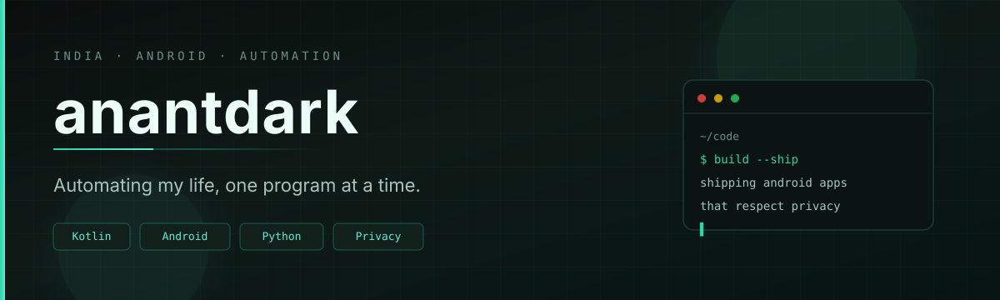

<!--
**anantdark/anantdark** is a special repository — this README appears on the GitHub profile.
-->

<p align="center">
  
</p>

<p align="center">
  <a href="https://anantdark.github.io"></a>
  <a href="mailto:anantpatel2000@proton.me"></a>
  <a href="https://f-droid.org/packages/com.anant.fitbuddy/"></a>
  
</p>

<p align="center">
  
</p>

### About

Android engineer building tools that stay out of the way — and out of your data.

I ship open-source apps with Kotlin & Jetpack Compose, automate the boring parts of life with Python, and treat privacy as a feature, not a footnote.

Currently deep in **Kotlin / Android** — calorie tracking, body metrics, rolling mic memory, and whatever else needs a better default.

<details>
<summary><b>Quick facts</b></summary>
<br/>

- Working on Kotlin & Android apps that ship to F-Droid and GitHub Releases
- Learning deeper Android platform work — Compose, Room, BLE, CI
- Open to collaborating on privacy-respecting tooling
- Reach me: [anantpatel2000@proton.me](mailto:anantpatel2000@proton.me)
- Fun fact: privacy comes at the cost of convenience — worth paying

</details>

<p align="center">
  
</p>

### Featured work

| Project | What it is |
| :--- | :--- |
| [**FitBuddy**](https://github.com/anantdark/FitBuddy) | AI-powered calorie & workout tracker for Android — region-aware diets, photo/text logging, on-device privacy. [F-Droid](https://f-droid.org/packages/com.anant.fitbuddy/) |
| [**Gecko**](https://github.com/anantdark/Gecko) | Time-travelling audio recorder — rolling mic memory for Android |
| [**FreeScale**](https://github.com/anantdark/FreeScale) | Open Android client for the Dr. Trust USA 532 smart scale |
| [**SplitBill**](https://github.com/anantdark/SplitBill) | Prepaid meter bill splitting for shared flats |
| [**macpaper**](https://github.com/anantdark/macpaper) | Register local videos & images as macOS wallpapers / screen savers |
| [**chromadesk**](https://github.com/anantdark/chromadesk) | Daily wallpaper app for GNOME |

<p align="center">
  <a href="https://github.com/anantdark/FitBuddy">
    
  </a>
  <a href="https://github.com/anantdark/Gecko">
    
  </a>
</p>

<p align="center">
  
</p>

### Stack

<p align="center">
  
</p>

<p align="center">
  <sub>Also fluent with · C / C++ · Neovim · Selenium · MongoDB · Figma</sub>
</p>

<p align="center">
  
</p>

### Pulse

<p align="center">
  
  
</p>

<p align="center">
  
</p>

<!--START_SECTION:waka-->
📊 **This Week I Spent My Time On** 

```text
💬 Programming Languages: 
No Activity Tracked This Week

🔥 Editors: 
No Activity Tracked This Week

💻 Operating System: 
No Activity Tracked This Week
```

🤖 **AI Coding This Week** 

```text
No AI Coding Activity Tracked This Week
```


 Last Updated on 01/11/2026 07:47:19 UTC
<!--END_SECTION:waka-->

<p align="center">
  
</p>

<p align="center">
  <sub>Built with care · open source preferred · privacy by default</sub><br/>
  <a href="mailto:anantpatel2000@proton.me">anantpatel2000@proton.me</a>
  ·
  <a href="https://anantdark.github.io">anantdark.github.io</a>
</p>
